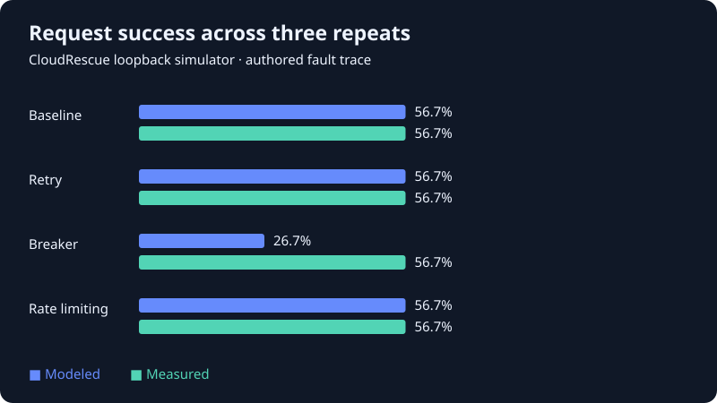

# External validation report

## Objective and environment

Compare the Phase 4 model with real HTTP requests to the CloudRescue simulator. This is local empirical validation of a software model, with no independent reviewers, externally supplied traces, or production services. Windows, CPython 3.12.13, HTTPX 0.28.1. Each run owns an ephemeral IPv4 loopback listener and uses the existing simulator HTTP handler with a private in-memory fault provider. PostgreSQL, the ordinary dashboard, and the live monitoring worker are outside the experiment.

## Workload and measures

The authored recovery fixture starts healthy, adds 750 ms server latency, disconnects, returns HTTP 500, then returns to healthy. It offers 60 requests over 12 one-second windows. Each policy is measured with seeds 42, 77, and 103. The load generator starts arrivals in the first 300 ms of each window, caps in-flight HTTP at four, and applies a 650 ms end-to-end deadline. Retries are restricted to transport failures on modeled safe operations. Each run is capped at 15 seconds for this fixture.

Impaired means under 90% request success within a window. Recovery is the first fully successful window after the last impaired window. Throughput is successful responses per planned second. Latency is per-request elapsed time including retry waits for requests that reached an HTTP attempt. Percentage errors exclude zero observed denominators.



| Policy | Modeled success | Measured success | Modeled impaired seconds | Measured impaired seconds |
| --- | ---: | ---: | ---: | ---: |
| Baseline | 56.67% | 56.67% | 5 | 5 |
| Retry | 56.67% | 56.67% | 5 | 5 |
| Circuit breaker | 26.67% | 56.67% | 9 | 5 |
| Rate limiting | 56.67% | 56.67% | 5 | 5 |

All measured runs recovered in window 7, with 2.83 successful requests per second and 43.33% unsuccessful requests. Per-run p95 latency ranged from 646.3 to 660.6 ms. For the breaker, signed success bias (model minus observation) was −30 percentage points, absolute percentage error was 52.94%, and impairment bias was +4 seconds (80% absolute percentage error). The other three policies had zero aggregate error on this fixture.

The measured success and impairment had zero sample variance across three repeats. That is evidence of repeatability for this scripted case. Three repeats on the same host and fault trace do not justify a population confidence interval. Three of six policy pairs agreed and three disagreed because the model ranked the breaker lower while measured success tied. The discrepancy is consistent with differences in request ordering and breaker timing. The model records failures at scheduled arrival times, while the HTTP harness records them on completion. The comparison also differs in arrival spacing and synthetic capacity. This experiment does not isolate the contribution of each difference.

## Scope

Failover and the combined policy were excluded because the measured listener has one instance. The trace does not stress the configured rate limiter or test probabilistic, recoverable network errors. It verifies application-level response recovery and does not measure incident closure by the monitoring worker. The independent-trace import path accepts sanitized local files. The included CSV and JSON examples are project-authored fixtures.

## Reproduce

```powershell
$env:PYTHONPATH = 'packages/reliability-traces'
uv run python -m tools.measured_traffic packages/reliability-traces/examples/recovery.csv --output validation-output/measured.json
uv run python -m tools.render_validation validation-output/measured.json docs/images/measured-success.svg
```

The timestamped JSON contains each HTTP response, policy, seed, impairment window, throughput, latency, and separate modeled output. Preserve and review trace provenance separately before attributing an external source.

## Azure SDK contribution

The Azure SDK investigation found two relevant reports with existing PRs. A duplicate patch would add little. See the [contribution investigation](azure-sdk-investigation.md). The recommended first review is a CloudRescue PR covering the trace validator and measurement evidence. The next scientific milestone is a preregistered, independently authored trace and a paired run with matching arrival and breaker timing semantics.
