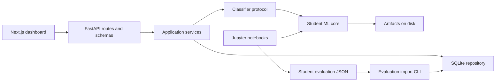

# Architecture

A modular monolith in one monorepo. Next.js is the browser-facing application; FastAPI
is the single application backend. ML is imported as a local Python package. There is
no separate inference service.

## Frontend

`frontend/src/app` contains the six App Router pages. Shared page components live in
`frontend/src/components`; the typed HTTP client lives in `frontend/src/lib/api.ts`.
All metrics and counts come from the backend. Missing data, loading, connection failures,
and unimplemented ML have distinct states. The UI does not invent model output.

## Backend

`backend/app/api` defines HTTP routes. Pydantic schemas validate request boundaries.
Services coordinate the classifier protocol, repository, and artifacts. The classifier
factory registry is injected into the service and can be replaced in isolated contract tests.

Prediction accepts text or a stored ticket ID. The latest registered model is the default;
a specific version can be requested. The service loads its artifact and invokes the classifier
contract. It validates output and persists the result only for a stored ticket. With no model
registered, the initial classifier stub is invoked and returns the clean development error.
A completed student implementation must be trained and registered before it can serve output.

Training creates a run record, passes labeled tickets to the selected classifier's fit method,
and calls save. Only an existing artifact can be registered. Success marks the run completed;
exceptions mark it failed. No metrics, dataset split, or feature preparation are performed
by the backend. Training remains synchronous for V1.

## Database

SQLite uses Python's standard sqlite3 module, parameterized values, transaction context
managers, foreign keys, and database-level constraints. `database/session.py` owns connections
and initialization; `database/models.py` contains the schema; `database/repository.py`
owns storage operations.

- `tickets`: raw text, optional actual/predicted label, confidence, model version, creation time.
- `model_versions`: implementation identifier, unique version, artifact path, registration time.
- `evaluation_results`: model version, validated student-produced metrics JSON, creation time.
- `training_runs`: implementation, lifecycle status, optional model version/error, timestamps.

Prediction model versions and evaluation versions reference the model registry. Changing
ticket text invalidates its stored prediction. Connections commit on success and roll back
on exceptions. Artifacts and database are not a distributed transaction; a failed registration
can leave an unreferenced file for manual cleanup. There is no migration system in this initial
empty-database scaffold; future schema changes require an explicit migration before reuse.

## ML laboratory

`ml/notebooks` contains six valid, unexecuted Jupyter notebooks with objectives, problem
statements, section headings, and empty student cells. `ml/data/raw` and `processed`
separate source and derived datasets. Jupyter, NumPy, pandas, scikit-learn, and matplotlib
are installed for student use. None are used to implement a classifier on the student's behalf.

## ML core

`ml/src/interfaces.py` defines the classifier protocol. The preprocessing, representations,
models, training, and evaluation packages contain student stubs only. They raise
`StudentMLNotImplemented`, a subclass of `NotImplementedError`, which is translated to
HTTP 501. Keep this exception when a component remains incomplete.

Concrete model classes inherit the five unimplemented methods from `models/base.py`.
Implement overrides in each model's own file. API routes depend on the protocol, never
model-specific math. Student-owned ML tests belong in `ml/tests`.

## Model artifacts

Artifacts live under the configured `ARTIFACT_DIR`. The database stores only their paths
and metadata. Training generates a unique version and target filename. Inference requires
an existing file whose resolved path remains inside that directory. Serialization is a
student contract method; the backend does not deserialize arbitrary data itself.

## Information flow

Ticket creation is a database operation. Classification and training cross the ML boundary.
Model and evaluation listing are storage operations and work even while ML is incomplete.
